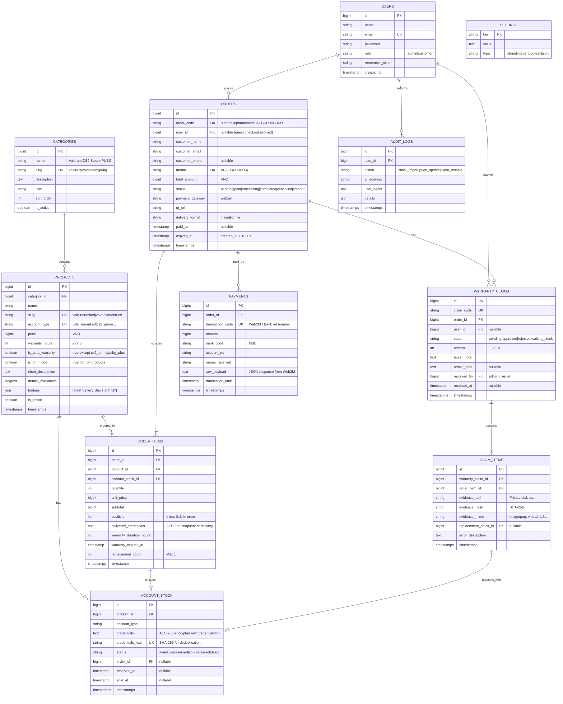
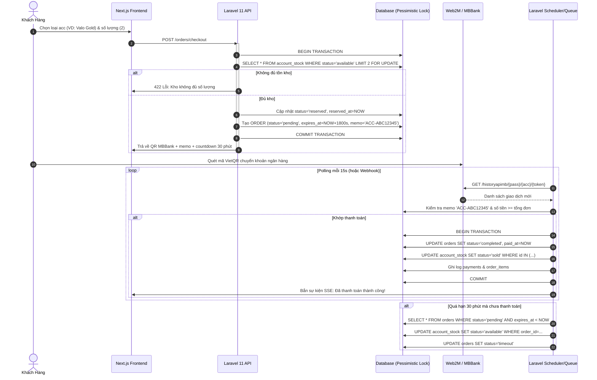
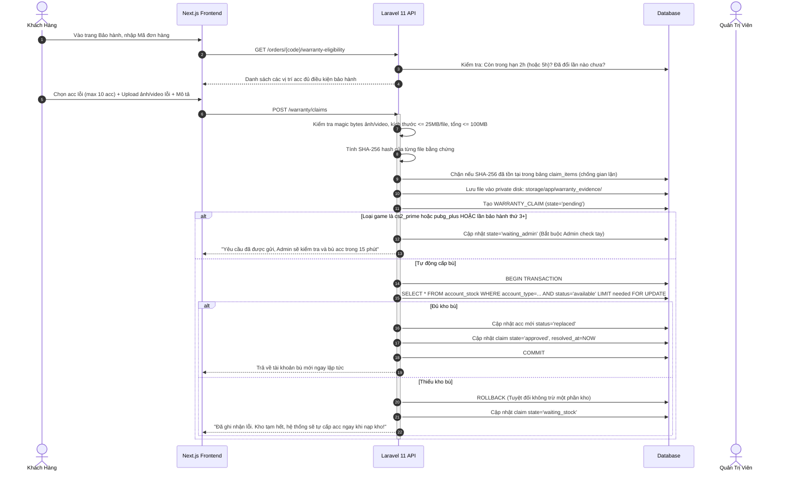

# KIẾN TRÚC HỆ THỐNG WEB E-COMMERCE BÁN TÀI KHOẢN GAME (SYSTEM ARCHITECTURE)

> **Dự án**: DTFF Gaming Shop (Chuyển đổi từ Discord Bot `SellAccfix`)  
> **Kiến trúc**: Monorepo Decoupled Architecture (`/backend` Laravel 11 REST API + `/frontend` Next.js 14/15 App Router)

---

## 1. SƠ ĐỒ THỰC THỂ LIÊN KẾT (ENTITY RELATIONSHIP DIAGRAM - ERD)



---

## 2. DANH SÁCH RESTFUL API SPECIFICATION

Toàn bộ API trả về JSON chuẩn theo cấu trúc:
```json
{
  "success": true,
  "data": { ... },
  "message": "Thông báo nếu có",
  "meta": { ... }
}
```

### 2.1. Public Catalog & Storefront API
| Phương thức | Endpoint | Mô tả | Quyền |
| :--- | :--- | :--- | :--- |
| `GET` | `/api/v1/categories` | Lấy danh mục game kèm số lượng sản phẩm | Public |
| `GET` | `/api/v1/categories/{slug}` | Chi tiết danh mục kèm sản phẩm và SEO data | Public |
| `GET` | `/api/v1/products` | Danh sách sản phẩm, lọc theo game, trạng thái còn hàng | Public |
| `GET` | `/api/v1/products/{slug}` | Chi tiết sản phẩm, giá, tồn kho realtime, đánh giá | Public |
| `GET` | `/api/v1/store/stats` | Thống kê số lượng acc đã bán, số người xem online | Public |

### 2.2. Checkout & Payment API
| Phương thức | Endpoint | Mô tả | Quyền |
| :--- | :--- | :--- | :--- |
| `POST` | `/api/v1/orders/checkout` | Tạo đơn hàng, giữ chỗ kho (reserve), sinh QR VietQR | Public / Guest |
| `GET` | `/api/v1/orders/{order_code}/status` | Tra cứu trạng thái đơn hàng (polling/status) | Public (Order Token/Guest) |
| `GET` | `/api/v1/orders/{order_code}/stream` | Server-Sent Events (SSE) theo dõi biến động thanh toán | Public |
| `POST` | `/api/v1/webhooks/web2m` | Webhook nhận biến động số dư từ Web2M (nếu có) | Web2M Secret |

### 2.3. Delivery & Check Acc API
| Phương thức | Endpoint | Mô tả | Quyền |
| :--- | :--- | :--- | :--- |
| `GET` | `/api/v1/orders/{order_code}/details` | Xem chi tiết đơn hàng & acc đã mua | Chủ đơn / Auth |
| `GET` | `/api/v1/orders/{order_code}/download` | Tải file TXT danh sách tài khoản | Chủ đơn / Auth |
| `GET` | `/api/v1/orders/{order_code}/check-acc/{position}` | Xem chi tiết thông tin acc, skin, rank, dao | Chủ đơn / Auth |
| `GET` | `/api/v1/orders/{order_code}/download-html` | Tải file HTML 3D Interactive Kho Acc | Chủ đơn / Auth |

### 2.4. Warranty (Bảo Hành) API
| Phương thức | Endpoint | Mô tả | Quyền |
| :--- | :--- | :--- | :--- |
| `GET` | `/api/v1/orders/{order_code}/warranty-eligibility` | Kiểm tra các acc còn hạn bảo hành trong đơn | Chủ đơn / Auth |
| `POST` | `/api/v1/warranty/claims` | Gửi yêu cầu bảo hành (kèm upload 1 ảnh/video mỗi acc) | Chủ đơn / Auth |
| `GET` | `/api/v1/warranty/claims/{claim_code}` | Tra cứu trạng thái xử lý bảo hành | Chủ đơn / Auth |
| `GET` | `/api/v1/warranty/evidence/{id}` | Xem file bằng chứng (Temporary Signed URL) | Chủ đơn / Admin |

### 2.5. Admin Management API (Laravel Sanctum - Role: Admin)
| Phương thức | Endpoint | Mô tả | Quyền |
| :--- | :--- | :--- | :--- |
| `GET` | `/api/v1/admin/dashboard` | Thống kê doanh thu, số đơn, tồn kho, yêu cầu BH | Admin |
| `GET/POST` | `/api/v1/admin/products` | CRUD sản phẩm, cập nhật giá | Admin |
| `POST` | `/api/v1/admin/stock/import` | Nạp kho bằng file TXT hoặc paste text | Admin |
| `GET` | `/api/v1/admin/stock` | Xem danh sách kho tồn, phân trang, lọc trạng thái | Admin |
| `GET` | `/api/v1/admin/orders` | Danh sách đơn hàng, tìm kiếm, xuất báo cáo Excel | Admin |
| `POST` | `/api/v1/admin/orders/{code}/force-complete` | Khớp đơn tay cho khách | Admin |
| `GET` | `/api/v1/admin/warranty` | Danh sách yêu cầu bảo hành chờ duyệt | Admin |
| `POST` | `/api/v1/admin/warranty/{id}/approve` | Duyệt bảo hành & cấp bù acc thủ công | Admin |
| `POST` | `/api/v1/admin/warranty/{id}/reject` | Từ chối bảo hành kèm lý do | Admin |

---

## 3. SƠ ĐỒ LUỒNG ĐƠN HÀNG & BẢO HÀNH (STATE MACHINES)

### 3.1. Luồng Đơn Hàng & Giữ Chỗ Kho (Order Lifecycle)



### 3.2. Luồng Bảo Hành Tự Động (Warranty Lifecycle)



---

## 4. CHIẾN LƯỢC BẢO MẬT TOÀN DIỆN (SECURITY ARCHITECTURE)

1. **Mã hóa tài khoản ở trạng thái tĩnh (Encryption at Rest)**:
   * Toàn bộ mật khẩu, cookie, mã đăng nhập game được mã hóa bằng thuật toán `AES-256-CBC` với App Key được quản lý nghiêm ngặt qua biến môi trường.
2. **Chống tấn công IDOR (Insecure Direct Object Reference)**:
   * Khách hàng truy cập đơn hàng phải có Token xác thực đơn hàng hoặc đăng nhập đúng tài khoản sở hữu.
   * File bằng chứng bảo hành không công khai URL trực tiếp, chỉ truy cập qua Temporary Signed URL có thời hạn tối đa 15 phút.
3. **Chống Upload File Độc Hại**:
   * Kiểm tra MIME-type, phần mở rộng và đọc **Magic Bytes** trực tiếp (VD: `FF D8 FF` cho JPEG, `89 50 4E 47` cho PNG, `00 00 00 ... ftyp` cho MP4).
   * File lưu trữ không có quyền thực thi (`chmod 600`), tên file được hash ngẫu nhiên bằng UUIDv4.
4. **Rate Limiting & Chống Brute Force**:
   * Login: Tối đa 5 lần/phút.
   * Checkout: Tối đa 10 lần/phút/IP.
   * Check đơn/Tra cứu: Tối đa 30 lần/phút.
5. **Chống SQL Injection, XSS & CSRF**:
   * Sử dụng Eloquent ORM và Prepared Statements 100%.
   * Sanitization mọi input người dùng.
   * CORS được whitelist chính xác domain frontend Next.js.

---

## 5. CHIẾN LƯỢC SEO CHUẨN TỐI ƯU (SEO TECHNICAL STRATEGY)

1. **Cấu trúc URL Thân Thiện (Clean Slugs)**:
   * Trang chủ: `/`
   * Danh mục game: `/valorant`, `/cs2`, `/steam`, `/pubg`
   * Trang sản phẩm: `/valorant/acc-valorant-diamond-chu-off`, `/cs2/acc-cs2-prime`
   * Blog hướng dẫn: `/huong-dan/cach-doi-mat-khau-acc-valorant`
2. **Metadata & OpenGraph Động (Dynamic Metadata)**:
   * Mỗi trang có `generateMetadata` riêng biệt: Title 50–60 ký tự, Description 140–160 ký tự, Canonical URL tự động, OpenGraph Image động.
3. **Structured Data (JSON-LD)**:
   * `Organization` & `WebSite` với SearchAction ở trang chủ.
   * `Product` + `Offer` với giá tiền VND, tình trạng còn hàng (`InStock` / `OutOfStock`) khớp 100% với tồn kho thực tế.
   * `BreadcrumbList` cho mọi trang con.
   * `FAQPage` cho trang danh mục và FAQ.
4. **Sitemap & Robots**:
   * `app/sitemap.ts`: Tự động sinh danh sách toàn bộ danh mục, sản phẩm, bài viết với `lastModified` chuẩn xác.
   * `app/robots.ts`: Chặn bot index các trang riêng tư (`/admin`, `/checkout`, `/don-hang/*`).
5. **Core Web Vitals & Hiệu Năng**:
   * Toàn bộ sản phẩm được fetch phía Server (Server Component + ISR revalidate 60s), cấm fetch bằng `useEffect`.
   * Ảnh tối ưu tự động bằng `next/image` định dạng AVIF/WebP.
   * LCP < 2.5s, CLS < 0.1, INP < 200ms.
6. **Conversion Tracking**:
   * GA4 + Facebook Pixel tích hợp phía Client.
   * **Facebook Conversions API (CAPI)** bắn trực tiếp từ Laravel khi đơn hàng chuyển trạng thái `completed`, deduplicate qua `event_id = order_code`.
