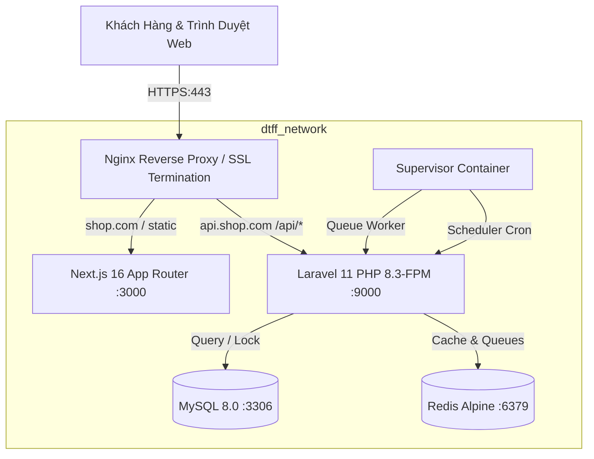

# HƯỚNG DẪN TRIỂN KHAI HỆ THỐNG (DEPLOY.MD)

Tài liệu hướng dẫn chi tiết quy trình triển khai hệ thống bán tài khoản game DTFF SHOP (Laravel 11 REST API + Next.js 16 SSR/ISR) lên máy chủ VPS bằng Docker Compose.

---

## 1. KIẾN TRÚC HỆ THỐNG TRÊN VPS



---

## 2. YÊU CẦU MÁY CHỦ VPS
- **Hệ điều hành**: Ubuntu 22.04 LTS hoặc Ubuntu 24.04 LTS (x86_64).
- **Cấu hình tối thiểu**: 2 vCPU, 4GB RAM, 40GB SSD.
- **Cấu hình khuyến nghị**: 4 vCPU, 8GB RAM, 80GB NVMe.
- **Phần mềm bắt buộc**: Docker 24+, Docker Compose v2, Git.

---

## 3. CÁC BƯỚC TRIỂN KHAI BẰNG DOCKER COMPOSE

### Bước 1: Trỏ DNS Tên Miền
Tại trang quản lý DNS (Cloudflare, Namecheap, v.v.), trỏ 2 bản ghi `A` về IP VPS:
- `shop.com` -> `IP_VPS`
- `api.shop.com` -> `IP_VPS`

### Bước 2: Clone Mã Nguồn Lên VPS
```bash
cd /var/www
git clone https://github.com/Minhtung0510/SellAccfix.git dtff-shop
cd dtff-shop
```

### Bước 3: Tạo File Môi Trường `.env` Cho Triển Khai
Tạo file `.env` tại thư mục gốc của dự án:
```bash
cat << 'EOF' > .env
# TÊN MIỀN & ỨNG DỤNG
APP_NAME="DTFF SHOP"
APP_ENV=production
APP_DEBUG=false
APP_URL=https://api.shop.com
NEXT_PUBLIC_API_URL=https://api.shop.com/api/v1

# CƠ SỞ DỮ LIỆU MYSQL
DB_DATABASE=dtffshop
DB_USERNAME=dtff_prod_user
DB_PASSWORD=SuperStrongPassword_2026!
DB_ROOT_PASSWORD=RootSuperStrongPassword_2026!

# THANH TOÁN WEB2M & TPBANK
BANK_CODE=TPB
ACCOUNT_NO=0987654321
ACCOUNT_NAME="NGUYEN VAN MINH TUNG"
WEB2M_TOKEN=your_web2m_token_here
WEB2M_PASSWORD=your_web2m_password_here
PENDING_TTL_SECONDS=1800
PAYMENT_TEST_MODE=false

# FACEBOOK CONVERSIONS API (TÙY CHỌN)
FB_PIXEL_ID=
FB_CAPI_TOKEN=
EOF
```

Copy file `.env` cho backend Laravel:
```bash
cp .env backend/.env
# Tạo application encryption key cho AES-256
docker run --rm -v $(pwd)/backend:/app -w /app composer:2 composer install --no-dev
docker run --rm -v $(pwd)/backend:/app -w /app php:8.3-cli php /app/artisan key:generate
```

### Bước 4: Khởi Chạy Hệ Thống Bằng 1 Lệnh Duy Nhất
```bash
docker compose up -d --build
```

Kiểm tra trạng thái các container:
```bash
docker compose ps
```
Kết quả mong muốn: cả 5 container (`dtff_mysql`, `dtff_redis`, `dtff_backend`, `dtff_frontend`, `dtff_nginx`) đều ở trạng thái `Up` (healthy).

### Bước 5: Chạy Migration, Seeder & Import Kho
```bash
# Chạy migration DB
docker compose exec backend php artisan migrate --force

# Seed tài khoản quản trị mặc định (admin@dtffshop.com / password123)
docker compose exec backend php artisan db:seed --force

# Import kho hàng từ các file TXT cũ của bot Discord
docker compose exec backend php artisan inventory:import-legacy /var/www/backend/legacy_stock
```

---

## 4. CẤU HÌNH SSL HTTPS VỚI LET'S ENCRYPT & CERTBOT

### Bước 1: Cài đặt Certbot trên VPS Host
```bash
sudo apt update
sudo apt install -y certbot python3-certbot-nginx
```

### Bước 2: Sinh Chứng Chỉ SSL Cho 2 Tên Miền
```bash
sudo certbot certonly --webroot -w /var/www/dtff-shop/backend/public \
    -d shop.com -d api.shop.com \
    --email admin@dtffshop.com --agree-tos --non-interactive
```

### Bước 3: Cấu hình Nginx Kích Hoạt SSL
Mở file `docker/nginx/conf.d/app.conf` và cập nhật cổng 443 cùng đường dẫn chứng chỉ:
```nginx
server {
    listen 443 ssl http2;
    server_name shop.com;

    ssl_certificate /etc/letsencrypt/live/shop.com/fullchain.pem;
    ssl_certificate_key /etc/letsencrypt/live/shop.com/privkey.pem;
    ssl_protocols TLSv1.2 TLSv1.3;
    ssl_ciphers HIGH:!aNULL:!MD5;

    location / {
        proxy_pass http://frontend_upstream;
        # ... proxy headers ...
    }
}
```
Khởi động lại Nginx:
```bash
docker compose restart nginx
```

---

## 5. QUẢN LÝ QUEUE WORKER & SCHEDULER

Hệ thống đã tích hợp sẵn **Supervisor** bên trong container `dtff_backend`. Không cần cài Supervisor ở ngoài máy chủ host!
- **Queue Worker**: 2 tiến trình lắng nghe hàng đợi Redis (`queue:work redis --sleep=3 --tries=3`). Tự động xử lý kiểm tra Web2M, giải phóng đơn quá hạn và gửi Facebook CAPI.
- **Scheduler**: Chạy vòng lặp tự động gọi `php artisan schedule:run` mỗi 60 giây.
- **Xem log worker**:
  ```bash
  docker compose exec backend tail -f /var/www/backend/storage/logs/worker.log
  ```
- **Xem log scheduler**:
  ```bash
  docker compose exec backend tail -f /var/www/backend/storage/logs/scheduler.log
  ```

---

## 6. KỊCH BẢN SAO LƯU TỰ ĐỘNG HẰNG NGÀY (DAILY BACKUP)

Tạo script sao lưu tự động tại `/root/backup_dtff.sh`:
```bash
#!/bin/bash
BACKUP_DIR="/root/backups"
TIMESTAMP=$(date +"%Y%m%d_%H%M%S")
mkdir -p "$BACKUP_DIR"

# 1. Sao lưu MySQL Database (Dump nén gz)
docker compose -f /var/www/dtff-shop/docker-compose.yml exec -T mysql \
    mysqldump -u dtff_prod_user -pSuperStrongPassword_2026! dtffshop \
    | gzip > "$BACKUP_DIR/db_$TIMESTAMP.sql.gz"

# 2. Sao lưu thư mục bằng chứng bảo hành (Evidence files)
tar -czf "$BACKUP_DIR/evidence_$TIMESTAMP.tar.gz" \
    /var/lib/docker/volumes/dtff-shop_backend_storage/_data/app/warranty_evidence

# 3. Tự động xóa bản sao lưu cũ hơn 14 ngày để tiết kiệm dung lượng
find "$BACKUP_DIR" -type f -name "*.gz" -mtime +14 -delete

echo "[$(date)] Backup completed successfully to $BACKUP_DIR"
EOF
chmod +x /root/backup_dtff.sh
```

Cấu hình Cron trên VPS Host để tự động chạy lúc 02:00 sáng hàng ngày:
```bash
crontab -e
```
Thêm dòng:
```cron
0 2 * * * /root/backup_dtff.sh >> /var/log/dtff_backup.log 2>&1
```

---

## 7. CẬP NHẬT MÃ NGUỒN KHÔNG GIÁN ĐOẠN (ZERO-DOWNTIME DEPLOY)

Khi có bản cập nhật mới trên GitHub:
```bash
cd /var/www/dtff-shop
git pull origin main

# Build lại container backend và frontend
docker compose build backend frontend

# Khởi chạy lại container
docker compose up -d

# Clear cache Laravel
docker compose exec backend php artisan optimize:clear
docker compose exec backend php artisan optimize
```
